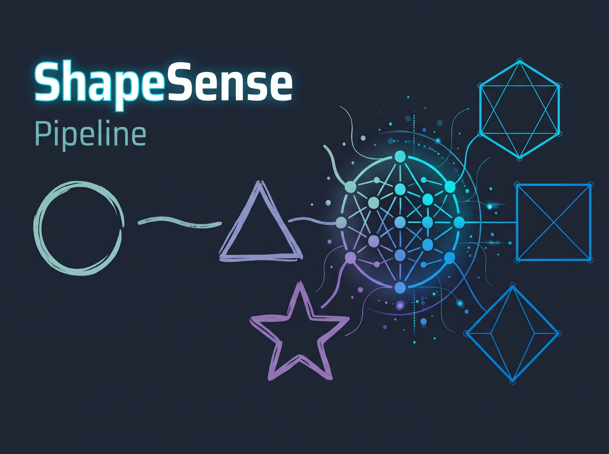

<p align="center">
  
</p>

# ShapeSense — Phase 2 pipeline

ShapeSense trains a small CNN to classify ten 2D shapes (circle, ellipse,
triangle, square, rectangle, pentagon, hexagon, octagon, star, diamond) and
tests one question: **does adding procedurally generated (synthetic) shapes
to training help?** Three arms are trained with identical settings and only
the data stream differs:

| Arm | Training data |
|---|---|
| A0 | real images only |
| A1 | real images + class-safe augmentation |
| B  | 70 % real + 30 % synthetic per batch, all augmented |

The full plan is [`implementation.md`](implementation.md); each stage owner
has a brief in [`stages/`](stages/). This README takes a new teammate from a
fresh copy of the repository to a running pipeline.

## 1. Prerequisites

- Windows 10/11 (macOS/Linux also work; commands below are PowerShell).
- Python **3.12** (see `.python-version`), on `PATH`.
- A LaTeX distribution for the report: MiKTeX (preferred; installs missing
  packages on demand) or TeX Live. `build.ps1` finds either.
- About 2 GB of disk for the raw data and artifacts. A GPU is optional; the
  whole pipeline runs on CPU.

## 2. Environment

```powershell
python -m venv .venv
.\.venv\Scripts\Activate.ps1
pip install -r requirements.txt --extra-index-url https://download.pytorch.org/whl/cpu
```

Every dependency is pinned to an exact version in `requirements.txt`. For a
GPU build of PyTorch, install the matching CUDA wheel first; nothing else
changes.

Pre-commit hooks (import boundaries + contract tests) are optional and local: `.pre-commit-config.yaml` is not tracked, so only a machine that has a copy can install them. `python run_pipeline.py --check` runs the same guards everywhere:

```powershell
pre-commit install
```

## 3. Data

`data_set/` is not in Git. Get it from the team's shared folder (Decision 5):

1. Copy the raw archive into `data_set/` so it contains `quickdraw/`,
   `kaggle_reevald/`, `2D geometric shapes dataset/`, `github_handdrawn/`
   (and the built `unified/` folder if the archive has it).
2. Check the hash. The published value is in
   `artifacts/stage0/data_archive_sha256.txt` on the machine that published
   the archive; Stage 0 recomputes it on yours:

   ```powershell
   python -c "from src.stage0_infra.data_archive import archive_sha256; print(archive_sha256('data_set', exclude=['unified']))"
   ```

   The two values must match exactly. A mismatch means a different dataset.
3. If `data_set/unified/` is missing, build it (about 5 minutes):

   ```powershell
   python -m src.stage1_freeze.build_unified_dataset
   ```

## 4. Running

| Command | What it does |
|---|---|
| `python run_pipeline.py` | guards, then every stage whose inputs changed |
| `python run_pipeline.py --stages 3` | one stage plus the stages it depends on |
| `python run_pipeline.py --check` | guards only: import boundaries + contract tests |
| `python run_pipeline.py --force` | ignore the cache and rerun everything |
| `python run_pipeline.py --dashboard` | read-only progress dashboard (Streamlit) |
| `python run_pipeline.py --demo` | draw a shape and see the model's prediction |
| `python -m pytest tests -q` | the full test suite (no data needed) |
| `.\build.ps1 -File phase2_report.tex` | compile the Phase 2 report by hand |

How the runner works:

- One **run id** is minted per invocation and written into every stage's
  `artifacts/stageN/status.json`.
- The **guards** (`lint-imports` and `pytest tests/contracts`) run first. A
  failing guard stops the run before any stage executes.
- Each stage records the hash of every input it read. A stage whose inputs
  are unchanged and whose last status is `passed` is skipped (`cached`).
- A failing stage stops the run; later stages do not run.

Expect Stage 4 (training) to take hours on a CPU. Its loader benchmark
(`artifacts/stage4/loader_benchmark.json`) estimates the total before the
sweep starts.

## 5. Stages, owners and artifacts

Owners are assigned from `team.json`; until then `CODEOWNERS` holds
placeholders.

| Stage | Code | Main outputs | Owner |
|---|---|---|---|
| 0 Infrastructure | `src/common/`, `src/stage0_infra/`, `run_pipeline.py` | `artifacts/stage0/` (migration check, data hash, guards) | ______ |
| 1 Data freeze | `src/stage1_freeze/` | `configs/splits/{train,val,test}.csv` (committed), `artifacts/stage1/` | ______ |
| 2 Augmentation | `src/stage2_augment/` | `transform(img, label, rng)`, QA sheet | ______ |
| 3 Synthetic | `src/stage3_synth/` | `generate(label, rng)`, QA sheet, `param_ranges.json` | ______ |
| 4 Training | `src/stage4_train/` | `artifacts/stage4/<arm>_<seed>/`, baselines, tuning, benchmark | ______ |
| 5 Evaluation | `src/stage5_eval/` | `artifacts/stage5/` tables, figures, verdict | ______ |
| 6 Report | `src/stage6_report/`, `dashboard/`, `demo/`, `export/` | Phase 2 report PDF, `export/` bundle | ______ |

Rules every stage follows (enforced, not by convention):

- **Stages do not import each other.** The only exception: Stage 4 uses
  `stage2_augment.build_transform` and `stage3_synth.build_generator`.
  `dashboard/` may import `src.common.status` only; `demo/` only `export/`.
- **The test split is sealed.** `common.load_split("test")` raises unless the
  caller is in `src.stage5_eval`, and every read is appended to
  `artifacts/test_access.log` (never truncate it).
- **Every number lives in `configs/`.** `configs/pipeline.yaml` holds the
  experimental settings; `configs/taxonomy.yaml` holds the class definitions.
  Both are frozen after Stage 1; changing them needs a reviewed PR.

## 6. Repository layout

```
configs/            pipeline.yaml, taxonomy.yaml, splits/ (frozen manifests)
src/common/         shared contracts: config, status, splits, hashing, catalog, ...
src/stage0_infra/   Stage 0 checks (migration equivalence, data hash)
src/stage1_freeze/  Phase 1 build + Stage 1 freeze (moved from scripts/)
src/stage2..6_*/    one package per stage, entry point run.py
tests/              pytest: contracts/ (public interfaces) and one folder per stage
dashboard/ demo/ export/   presentation layer and the exported model bundle
artifacts/          stage outputs (gitignored except .gitkeep)
ignore/             tracker (todo.md) and implementation plans (plan/)
```

## 7. Troubleshooting (Windows)

- **"running scripts is disabled on this system"** when activating the venv:
  `Set-ExecutionPolicy -Scope CurrentUser RemoteSigned`, then reopen the
  terminal.
- **`python` opens the Microsoft Store** or is not found: install Python 3.12
  from python.org with "Add python.exe to PATH" ticked, or disable the
  `python.exe` App execution alias in Windows settings.
- **`pdflatex` not found** or missing packages: install MiKTeX and let it
  install packages on the fly; `build.ps1` prefers MiKTeX over TeX Live.
- **Pre-commit hooks do not run**: they need `git` and Python on `PATH` in the
  same shell that runs `git commit`.
- **`--dashboard` cannot import `dashboard`**: start it through the runner (it
  uses `python -m streamlit run` from the repository root).
- **Stage 4 is slow**: lower `train.parallel_runs` if the machine has fewer
  than 12 cores; results do not change (each run is seeded by arm and seed).

## 8. Optional: DVC

The pipeline does not need DVC. The file contracts (inputs, outputs and their
hashes in `status.json`) map one-to-one onto `dvc.yaml` stages if the team
adopts it later.

## 9. Data and model credits

Training data: Quick, Draw! (Google, CC BY 4.0), Geometric Shapes
Mathematics by reevald (Kaggle, CC0), 2D geometric shapes dataset by El Korchi
(Mendeley Data, CC BY 4.0) and Hand-Drawn Shapes by frobertpixto (GitHub; data
CC BY 4.0, code MIT). Full attribution is in the report and
[`export/README.md`](export/README.md). The project's own license is a team
decision that has not been made yet.
