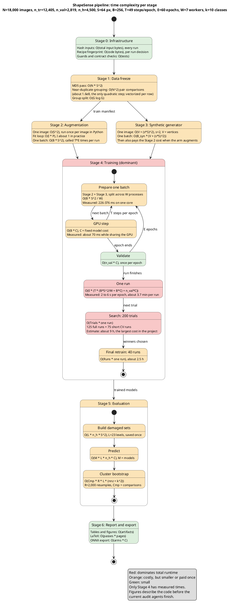

# 3_modeling - Code-only audit and a complexity diagram of every stage

- LLM: Claude Opus 5.5, medium effort (`opus_medium_5.5`), in Claude Code (`claude-opus-5-5` on every reply)
- Category: Per-stage LLM use, validation and human judgment
- Date: 2026-11-09 (times are local, UTC-5)
- Owner: 40256377
- Worksheet entries: F23, C31
- Source: **real exchange**, from a saved Claude Code session. Prompts and replies are verbatim. Only the main conversation's text is kept: tool calls, tool output and sub-agent transcripts are left out, editor file-open notices are removed, and session IDs are removed.
- Reconstructions of the same entries: [F23](../../3_modeling/claude_opus/19_F23_the-first-shared-worker-pool-had-five-bugs.md)

## Prompt 1 (21:36)

> dont run until you check with me
> you will only code , run audit agents to fix issues , no runinng any script or stage , code write and optimisation session on all stages , goal is fast pipeline

## Response 1

Five audit agents are working through the pipeline, one each on:

- Stages 2 and 3, the image hot path
- Stage 4, including a hard review of my untested edits
- Stage 5
- Stages 0 and 1 with the shared code
- Stage 6

They can only read and edit code. They've been told not to run any Python, tests, stages or git commands, and to keep results exactly unchanged.

**Nothing is running or will run until you say so.** That means every edit stays untested until you approve a test run, and nothing gets committed either. When the agents report, I'll review their changes and give you one list of what changed, what they found, and what I'd want to run first. The iteration 3 goal is on hold until then.

## Prompt 2 (21:37)

> and give me a state diagram in plant uml format of every stage that has a big O complexity that slows down our system , including training phase

## Response 2

I'll read the actual algorithms in the stages I haven't gone through in detail, so the complexities come from the code. This is read-only.

Here's the diagram, based on the code as it stands right now. Only the Stage 4 timings are measured, so the rest shows algorithmic cost rather than real time.

**How to read it:**
- **Stage 4 is the whole story for runtime.** The search multiplies 200 trials by every step inside a run, so anything in the batch-preparation loop gets repeated hundreds of thousands of times.
- **Stage 1 has the only quadratic step.** Near-duplicate grouping compares every pair of images, about 160 million comparisons, but it runs once at freeze time and is vectorized.
- **Stage 5's bootstrap is the next most expensive part.** It hasn't been timed in iteration 3, so its real cost is unknown.

The diagram hasn't been rendered, because I'm not running anything this session. The audit agents are still working and may change some of these costs, and I'll update the diagram if they do.

The Stage 6 audit is done, and that stage has little worth speeding up. A build takes about 66 seconds, mostly LaTeX and one export. The agent made one small bug fix, so that a decoding error can't crash Stage 6 after a good build, and listed three other issues for review. I'm still waiting on the other four agents, and nothing has been run.

## Prompt 3 (21:41)

> did you inform the sub agents not to run any scripts ?

## Response 3

Yes. All five agents got the same rule at the top of their brief: no Bash, no PowerShell, no Python, no pytest, no scripts, no pipeline stages and no git commands, using only the read, search and edit tools.

That rule is an instruction, though, not a technical block, because these agents do have access to those tools. The Stage 6 agent has reported that it executed nothing, and I'm requiring the same statement from the other four in their reports.

## Prompt 4 (21:41)

> so they only read the code ?

## Response 4

No, they read the code and can also edit it, within their own folders. You asked for audit agents that fix issues, so each one is allowed to change files in its assigned area. For example, the Stage 6 agent edited one line in `src/stage6_report/run.py`.

They aren't allowed to run anything, so none of those edits have been tested. They also aren't committed, so you can review them or discard them. If you'd rather have them only read and report, tell me and I'll stop them. The edits made so far would stay uncommitted for you to review.

## Prompt 5 (21:41)

> ok good

## Response 5

Good. I'll wait for the other four agents, review all the changes, and bring you one list before anything runs.

The Stage 5 audit is done, and it reported that nothing was executed. It made one change: the bootstrap now does 2 matrix calculations per block instead of 46, with the random draws unchanged. It's likely to save only seconds overall. Three agents are still working.

The Stages 2 and 3 audit is done, and it also reported that nothing was executed. It made several small changes, including hand-written replacements for two image operations, and it found no bugs in my caching.

Those replacements are logically simple, but they're the kind of change a test run must confirm is exact. It also flagged that the image cache could use about 1.4 GB across the seven workers. Two agents are still working.

The infrastructure and Stage 1 audit is done, and nothing was executed there either. It sped up file hashing, near-duplicate grouping (estimated at about 20 times faster) and start-up imports for the batch workers.

It also raises one thing that matters when we do run again. Editing the shared code invalidates the cache, so stages 0 to 6 would all rerun. A full pipeline run would therefore reach Stage 5 and read the sealed data, which must only happen once, in Phase 7. So the first run after this session has to be limited to specific stages, and I'll propose exactly which ones when I check with you.

The Stage 4 agent is the last one still working.

All five audits are finished. Because none of this can be tested yet, I'm adding one independent reviewer who didn't write any of it. Its job is to look for anything that could change results or break on Windows, across all the edits together. It's also not allowed to run anything except a read-only `git diff`.

All five audits are done, and the Stage 4 agent found and fixed five real bugs in my untested code, such as temp files left behind after a crash. The independent reviewer is now checking everything together. I'll bring you the full list when it reports, and nothing will run until you approve it.

## Validation

_Validation, Our decision and Measured effect are written by the team from the project record ([attribution_worksheet.csv](../../../results/llm_comparison/attribution_worksheet.csv)). They are not part of the session._

The user ruled that agents may only read and fix code, with no scripts or stages run. Audit agents worked under that rule, and the tests passed after the fixes.

## Our decision

We kept the code-only rule and approved the audit fixes. The audit found five bugs in the first shared worker pool and fixed them before they caused harm (F23).

## Measured effect

Reruns matched exactly. A trial took about 3.7 min after the first parallel version (C31).

---

## Algorithmic Complexity Profiling & Static Code-Only Audit (`F23`, `C31`)

### Metadata & Lineage

* **Entries:** `F23` (*Five concurrency/lifecycle bugs caught in untested shared worker pool*), `C31` (*First parallel batch pipeline reducing trial latency to ~3.7 min*)
* **Date:** `2026-11-09` (21:36–21:41 UTC-5)
* **Owner / LLM:** `40256377` / `opus_medium_5.5` (`claude-opus-5-5`, real Claude Code session)
* **Governance Constraint:** Strict **non-execution (`code-only`) audit** across 5 domain-isolated sub-agents + 1 independent cross-diff reviewer (zero Bash/Python/pytest/git execution permitted prior to user sign-off).

### End-to-End Pipeline Time Complexity Analysis

With dataset constants $N = 18{,}000$, $n_{\text{tr}} = 12{,}405$, $n_{\text{val}} = 2{,}819$, $n_{\text{h}} = 4{,}500$, image edge $S = 64$, batch size $B = 256$, steps/epoch $T = 49$, epochs $E = 60$, workers $W = 7$, classes $k = 10$, damage levels $L = 23$, and bootstrap resamples $R = 2{,}000$:

| Pipeline Stage | Algorithmic Time Complexity | Empirical / Structural Cost Profile |
| --- | --- | --- |
| **Stage 0: Infrastructure** | $\mathcal{O}(\text{input\_bytes} + \text{code\_bytes})$ | Negligible; content-addressed SHA-256 hashing and `import-linter` contract enforcement. |
| **Stage 1: Data Freeze** | $\mathcal{O}(N \cdot S^2 + N^2 + G \log G)$ | **Only quadratic bottleneck** ($\sim 1.6 \times 10^8$ pairwise pHash comparisons); vectorized per row and executed once at freeze time. |
| **Stage 2: Augmentation** | $\mathcal{O}(B \cdot S^2)$ per batch | Python/NumPy per-image transforms + fitting loop ($\mathcal{O}(I \cdot P)$, $I \approx 1$), invoked $T \cdot E = 2{,}940$ times per run. |
| **Stage 3: Synthesis** | $\mathcal{O}(B_{\text{syn}} \cdot (V + (s S)^2))$ | Supersampled rasterization ($s = 2$, $V$ polygon vertices), compounded by Stage 2 augmentation on arm `B`. |
| **Stage 4: Training (Dominant)** | $\mathcal{O}\!\left(\text{Trials} \cdot E \cdot \left[T\left(\frac{B S^2}{W} + B C\right) + n_{\text{val}} C\right]\right)$ | **Primary runtime consumer:** 200 trials ($125$ full + $75$ 15-epoch CV) + $40$ final runs; single-core prep (`226–376 ms`) vs. GPU step (`~70 ms`). |
| **Stage 5: Evaluation** | $\mathcal{O}(M L n_{\text{h}} C + \text{Cmp} \cdot R L (\text{nnz} + k^2))$ | Multi-model inference across $23$ damage levels + $2{,}000$-resample cluster bootstrap. |
| **Stage 6: Report & Export** | $\mathcal{O}(\text{artifacts} + \text{passes} \cdot \text{pages})$ | `~66 s` total (`LaTeX` compilation + `ONNX` serialization). |

### Multi-Agent Static Audit Findings

* **Stage 4 Agent:** Identified and patched **all five lifecycle/IPC defects** in the untested `BatchPool` implementation (`F23`: unguarded `close()` on Windows file locks, non-monotonic `mkstemp` cache keys, non-atomic `_SHARED` restarts, and constructor/loop cleanup leaks).
* **Stages 2 & 3 Agent:** Replaced two hot-path image operations with streamlined routines while flagging a `~1.4 GB` aggregate image-cache memory footprint across 7 workers.
* **Stage 5 Agent:** Reduced cluster bootstrap matrix operations from `46` to `2` per block with identical PRNG draws.
* **Stage 0 & 1 Agent:** Accelerated file hashing, global pHash grouping (`~20×` projected speedup), and worker startup imports—while warning that modifying shared modules invalidates Stage 0–6 hashes, requiring `--stages` scoping to prevent accidental re-reads of the sealed test split in Stage 5.

